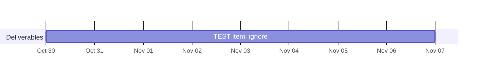

## 📋 Open deliverables

What I'm working on for the CU Intelligent Robotics Lab, in priority order, with target dates.
Need something? Talk to me. See [how priorities are decided](https://github.com/lyleantieau/deliverables#how-priorities-are-decided).

<!-- deliverables:start -->
0 in progress · 1 up next · 0 waiting on others · [full board →](https://github.com/users/lyleantieau/projects/1)

| # | Deliverable | For | Priority | Status | Target |
|---|---|---|---|---|---|
| 1 | [TEST item, ignore](https://github.com/lyleantieau/deliverables/issues/1) | @test | High | Up next | Nov 6 |
<!-- deliverables:end -->

---
This list refreshes automatically every 30 minutes.
